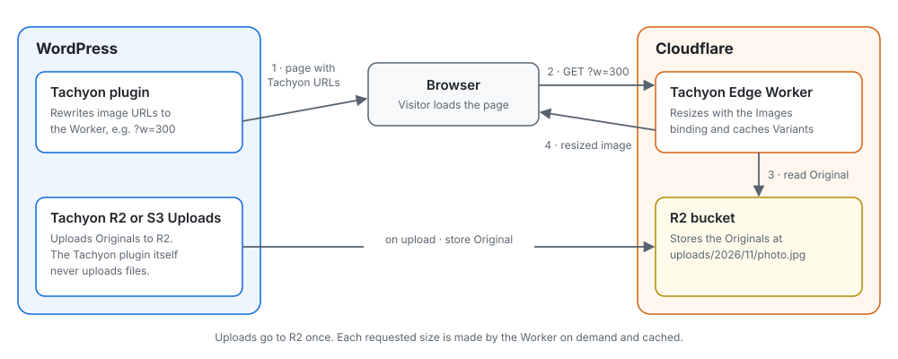

# Tachyon Edge

Tachyon Edge is an image service for the Tachyon WordPress plugin: [Tachyon Edge Images](https://github.com/soderlind/tachyon-edge-images) or [tachyon-plugin](https://github.com/humanmade/tachyon-plugin). It runs as a single Cloudflare Worker, processes images with the [Cloudflare Images binding](https://developers.cloudflare.com/images/transform-images/bindings/), and reads Originals from R2 or over HTTP.

It is a drop-in replacement for [Human Made Tachyon](https://github.com/humanmade/tachyon) v3.0.8 as far as the plugin is concerned. URLs, arguments, output sizes, crops, formats, status codes and cache headers follow the Plugin Contract ([ADR 0006](docs/adr/0006-compatibility-target-is-the-wordpress-plugin.md)). Pixels and file sizes differ, because the encoder is Cloudflare's rather than Sharp's.

## Architecture

In short: WordPress stores Originals in R2, the Tachyon plugin writes image URLs that point at the Worker, and the Worker resizes on request.



In detail:

<a href="https://raw.githubusercontent.com/soderlind/tachyon-edge/main/docs/diagrams/out/overview-light.svg">
<picture>
  <source media="(prefers-color-scheme: dark)" srcset="docs/diagrams/out/overview-dark.svg">
  
</picture>
</a>

A public request that misses the cache:

<a href="https://raw.githubusercontent.com/soderlind/tachyon-edge/main/docs/diagrams/out/public-miss-view-light.svg">
<picture>
  <source media="(prefers-color-scheme: dark)" srcset="docs/diagrams/out/public-miss-view-dark.svg">
  
</picture>
</a>

The private, presigned flow and the diagram sources are in [docs/diagrams](docs/diagrams).

Diagrams created with [Illustrate Design](https://github.com/soderlind/skills#illustrate-design).

The Worker does not rely on Cloudflare's `fit` heuristics. `geometry.ts` reproduces the arithmetic of Tachyon's Sharp pipeline, including `withoutEnlargement` rounding, JPEG shrink-on-load, EXIF rotation, `zoom` and the `px` Release Quirks. It then sends the binding explicit pixel operations ([ADR 0007](docs/adr/0007-process-with-the-cloudflare-images-binding.md)). A test oracle runs Tachyon v3.0.8's own code to check that the dimensions match ([ADR 0011](docs/adr/0011-geometry-oracle-and-remote-smoke-tests.md)).

Components, request flow, invariants and where to make changes are described in [docs/architecture.md](docs/architecture.md). Decisions are recorded in [docs/adr](docs/adr). The project language is in [GLOSSARY.md](GLOSSARY.md).

## Deploy

You need a Cloudflare account with Images enabled; the binding is billed per unique transformation. You also need Node 24.

```sh
npm ci
npx wrangler login
npx wrangler r2 bucket create tachyon-uploads   # or change bucket_name in wrangler.jsonc
npx wrangler deploy
```

Then copy your uploads into the bucket so that the Object Keys match the path after the Worker host. For example, `uploads/2026/11/photo.jpg` is served at `https://<worker>/uploads/2026/11/photo.jpg`. [rclone](https://developers.cloudflare.com/r2/examples/rclone/) and R2 [Super Slurper](https://developers.cloudflare.com/r2/data-migration/super-slurper/) can copy an existing S3 bucket.

### Configuration

Set these variables in [wrangler.jsonc](wrangler.jsonc):

| Variable | Purpose |
|---|---|
| `TACHYON_ORIGIN` | `r2` (default) reads from the `BUCKET` binding. `http` fetches from `TACHYON_HTTP_ORIGIN`. |
| `TACHYON_HTTP_ORIGIN` | Base URL for the HTTP Origin, e.g. `https://example.com/wp-content/`. Upstream 403 and 404 become 404; other failures become 502. |
| `TACHYON_R2_BUCKET` | Name of the bucket bound as `BUCKET`. It separates cached Variants per bucket. `wrangler deploy` fails if it differs from `bucket_name`, and the Worker skips its cache if it is empty. |
| `TACHYON_KEY_PREFIX` | Prepended to every Object Key before the Origin lookup. |
| `TACHYON_PRIVATE_PREFIXES` | Comma-separated storage key prefixes (`TACHYON_KEY_PREFIX` + Object Key) that require a valid presign, e.g. `uploads/private/`. |
| `TACHYON_SIGNING_ACCESS_KEY_ID` | The access key ID WordPress signs private URLs with. |
| `TACHYON_SIGNING_HOST` | Host in the presigned URL, e.g. `<account>.r2.cloudflarestorage.com` or `bucket.s3.eu-west-1.amazonaws.com`. |
| `TACHYON_SIGNING_PATH_PREFIX` | Path before the key in the presigned URL, e.g. `/bucket` for path-style URLs. Leave it empty for virtual-hosted URLs. |

The matching secret is set with `npx wrangler secret put TACHYON_SIGNING_SECRET_ACCESS_KEY`. For local development, copy [.dev.vars.example](.dev.vars.example) to `.dev.vars`.

Private prefixes fail closed. If signing credentials are missing, every private request returns 404 and the Worker logs a configuration error ([ADR 0009](docs/adr/0009-verify-presigns-for-private-prefixes.md)).

### WordPress

Install a Tachyon plugin and point it at the Worker. Use [Tachyon Edge Images](https://github.com/soderlind/tachyon-edge-images), a compatible fork with extra fixes, or the original [tachyon-plugin](https://github.com/humanmade/tachyon-plugin). Both read the same constants:

```php
define( 'TACHYON_URL', 'https://tachyon-edge.<subdomain>.workers.dev/uploads' );
define( 'TACHYON_SERVER_VERSION', '3.0.0' ); // presigned private images use `presign=`
```

To serve WebP to browsers that accept it, add a Transform Rule or another Worker in front that sets `X-WebP: 1` when `Accept` contains `image/webp`. The Worker caches WebP and non-WebP Variants separately.

## Uploading images

The Tachyon plugin only rewrites image URLs; it never uploads files. To get new uploads into the bucket, use one of these plugins. Both write to the Object Keys the Worker expects (`uploads/…`, or `uploads/sites/N/…` on multisite). Create an [R2 API token](https://developers.cloudflare.com/r2/api/tokens/) with *Object Read & Write* on the bucket for either one.

| | [S3 Uploads](https://github.com/humanmade/S3-Uploads) (Human Made) | [Tachyon R2](https://github.com/soderlind/tachyon-r2) |
|---|---|---|
| Install | Composer | Release zip |
| What goes to R2 | All uploads | Images the Worker serves; other files stay local |
| Local files | Never written | Kept (sync), deleted after upload (offload) or never written (stream) |
| Thumbnails | Written to R2 | Written to R2, or skipped and resized by Tachyon on request |
| Private uploads | Signed URLs; set `TACHYON_PRIVATE_PREFIXES` (R2 ignores the private ACL) | Not supported |

### S3 Uploads

```sh
composer require humanmade/s3-uploads
```

```php
define( 'S3_UPLOADS_BUCKET', 'tachyon-uploads' );
define( 'S3_UPLOADS_REGION', 'auto' );
define( 'S3_UPLOADS_KEY', '...' );     // R2 access key ID
define( 'S3_UPLOADS_SECRET', '...' );  // R2 secret access key
define( 'S3_UPLOADS_BUCKET_URL', 'https://tachyon-edge.<subdomain>.workers.dev' ); // Originals through the Worker
```

Point the S3 client at R2 in an mu-plugin, for example `wp-content/mu-plugins/s3-uploads-r2.php`:

```php
add_filter( 's3_uploads_s3_client_params', function ( $params ) {
	$params['endpoint'] = 'https://<account_id>.r2.cloudflarestorage.com';
	$params['use_path_style_endpoint'] = true;
	return $params;
} );
```

R2 has no per-object ACLs, so attachments S3 Uploads marks private are not protected by the bucket. Put them under a prefix listed in `TACHYON_PRIVATE_PREFIXES` and set the `TACHYON_SIGNING_*` variables so the Worker checks the presigned URLs ([ADR 0009](docs/adr/0009-verify-presigns-for-private-prefixes.md)).

### Tachyon R2

Download `tachyon-r2.zip` from the [latest release](https://github.com/soderlind/tachyon-r2/releases), install and activate it, then configure it in **Settings → Tachyon R2** or in `wp-config.php`:

```php
define( 'TACHYON_R2_ACCOUNT_ID', '...' );
define( 'TACHYON_R2_ACCESS_KEY_ID', '...' );
define( 'TACHYON_R2_SECRET_ACCESS_KEY', '...' );
define( 'TACHYON_R2_BUCKET', 'tachyon-uploads' );
define( 'TACHYON_R2_MODE', 'offload' );        // sync | offload | stream
define( 'TACHYON_R2_SKIP_THUMBNAILS', true );  // optional
```

The key prefix is taken from the path of `TACHYON_URL`. Check the connection with `wp tachyon-r2 status`, and copy an existing library with `wp tachyon-r2 sync --all`. See the [Tachyon R2 README](https://github.com/soderlind/tachyon-r2#readme) for the upload methods and limitations.

## Differences from Tachyon v3.0.8

These are listed in [ADR 0006](docs/adr/0006-compatibility-target-is-the-wordpress-plugin.md):

- **Images:** Variants have the same dimensions, but the pixels and file sizes are not byte-identical. EXIF and ICC metadata are stripped, except copyright. PNGs are truecolor rather than palette, so they are larger.
- **Animation:** percentage crops and `entropy`/`attention` on animated images return an image instead of Tachyon's error.
- **`zoom`:** a fractional zoomed size is rounded instead of causing an error.
- **AVIF:** output is labelled `image/avif`, not `image/heif`, and is capped at 1,200 px. Cloudflare documents AVIF Originals as Enterprise-only, but they worked on a non-Enterprise account in testing ([ADR 0007](docs/adr/0007-process-with-the-cloudflare-images-binding.md)).
- **Size limits:** Originals over 20 MB, and animations whose frames total 100 megapixels or more, are served unmodified.

## Development

```sh
npm test              # geometry oracle, plugin contract, SigV4 and Worker tests
npm run lint
npm run check:worker  # type-check against @cloudflare/workers-types
npx wrangler deploy --dry-run
```

Sharp is a dev dependency only. It runs the Tachyon v3.0.8 oracle ([tests/oracle](tests/oracle)) and backs the fake Images binding ([tests/helpers/fake-images.ts](tests/helpers/fake-images.ts)). Where patched Sharp changes EXIF resize results, the tests also check recorded historical geometry ([ADR 0011](docs/adr/0011-geometry-oracle-and-remote-smoke-tests.md)). The `wrangler dev` Images simulation is low-fidelity. Before production traffic, run the remote smoke test against a deployed Worker ([ADR 0011](docs/adr/0011-geometry-oracle-and-remote-smoke-tests.md)). Deploy with `TACHYON_PRIVATE_PREFIXES=uploads/private/` and no signing credentials, then:

```sh
node tests/remote/prepare.mjs /tmp/tachyon-smoke tachyon-uploads
TACHYON_SMOKE_URL=https://<worker>/uploads/ TACHYON_SMOKE_FIXTURES=/tmp/tachyon-smoke npm run test:remote
```

The WP-CLI acceptance test installs the Tachyon plugin on a WordPress site, uploads media and checks every image URL WordPress generates against the deployed Worker ([docs/acceptance-test.md](docs/acceptance-test.md)):

```sh
TACHYON_URL=https://<worker>/uploads node tests/acceptance/wp-site.mjs prepare
TACHYON_URL=https://<worker>/uploads npm run test:acceptance
```

## API reference

See [docs/using.md](docs/using.md).
